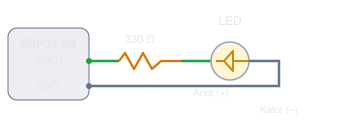

# ESP32-S3 Bare-Metal GPIO Blink

A small C and Xtensa assembly example that toggles GPIO4 using direct register access. It does not use ESP-IDF or an RTOS.

## Hardware

GPIO4 is the output.

## Circuit

## Tools

Requires GNU Make, the ESP32-S3 Xtensa toolchain, and `esptool` 5.x.
Install them separately; tool binaries are not included in this repository.

## Build

Put `xtensa-esp32s3-elf-gcc` and `esptool` on `PATH`, then run `make`. Output files are written to `build/`. Run `make clean` to remove generated build files.
